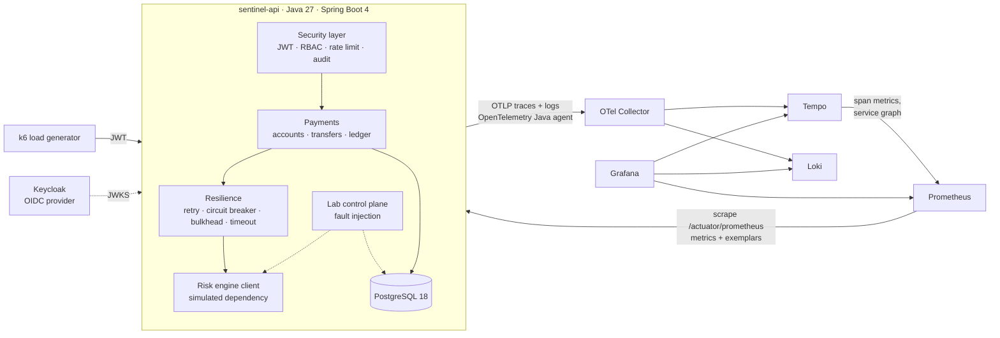

# Java Sentinel — Security & Observability Lab

An open source engineering lab where you **break a payments API on purpose, find the cause with telemetry and watch
the protections kick in**. Not another CRUD with dashboards: every component exists to make a production problem
reproducible and investigable.

**Java 27 · Spring Boot 4.1 · OpenTelemetry · Prometheus · Grafana · Tempo · Loki · Keycloak · PostgreSQL 18 · k6**

```bash
docker compose up -d --build                                     # whole stack, ~1 minute
docker compose --profile load run --rm k6                        # realistic traffic for 10 minutes
scripts/lab.sh scenario latency-jitter                           # inject an incident
open http://localhost:3000                                       # investigate
```

---

## What you can do with it

| Scenario | What breaks | What you observe | What protects you |
|---|---|---|---|
| [Latency & jitter](docs/scenarios/01-latency-jitter.md) | Risk engine gets slow and erratic | P50 ×6, **P99 ×28**, mean looks "fine", exemplar → trace shows the slow `CLIENT` span and retries | Time limiter, retry with exponential backoff + jitter, bounded retry budget |
| [Dependency outage](docs/scenarios/02-dependency-outage.md) | Risk engine fails 90% of calls | Circuit breaker opens within seconds, decision path switches to `fallback_*` | Circuit breaker, degradation policy (fail open for low value, fail closed above) |
| [Slow database](docs/scenarios/03-slow-database.md) | Funds transaction slows down while holding row locks | Pool 10/10 active, up to 40 pending, P99 ~9s because per-layer timeouts add up, 503s (never 500) | Small pool, connection/lock/statement timeouts, 503 + `Retry-After` |
| [Security attack](docs/scenarios/04-security-attack.md) | Forged tokens, IDOR probing, privilege escalation, flooding | Security events by type, audit trail in Loki correlated with traces | JWT validation (issuer, audience, signature), RBAC, ownership checks, per-client rate limiting |
| [Deadlock found under load](docs/scenarios/00-deadlock-found-under-load.md) | **A real bug the lab found in its own code** | 73% failures, P95 5.6s → after the fix P95 52ms | Lock ordering, `FOR NO KEY UPDATE`, regression test |

The lab has already caught two real bugs in its own code: the deadlock above, and PostgreSQL lock timeouts surfacing
as 500 instead of 503 (found while measuring the slow-database scenario, see its *Findings* section).

## Architecture



Signals and how they connect:

- **Metrics**: Micrometer → Prometheus (RED, USE, JVM, HikariCP, Resilience4j, business and security counters).
  Latency histograms carry **exemplars** (`trace_id`), so a point on a P99 panel opens the exact trace.
- **Traces**: OpenTelemetry Java agent (zero-code HTTP, JDBC, logging) plus manual spans for the business flow
  (`transfer execute` → `risk assessment` → `risk-engine POST /v1/score` per attempt).
- **Logs**: JSON (ECS) on stdout and OTLP to Loki, with `trace_id`/`span_id` and audit key-values as structured
  metadata. Loki → Tempo and Tempo → Loki links are provisioned.

Details: [docs/observability.md](docs/observability.md) · [docs/architecture](docs/architecture/README.md) ·
[docs/threat-model.md](docs/threat-model.md)

## Quick start

Requirements: Docker with Compose v2 and ~4 GB RAM for Docker. No local JDK needed (the image builds with JDK 27).

```bash
docker compose up -d --build
docker compose ps                     # wait until sentinel-api is "healthy"
```

| URL | What | Credentials |
|---|---|---|
| http://localhost:3000 | Grafana (dashboard **Sentinel — APM & Security** is the home page) | anonymous, or `admin` / `admin-lab` |
| http://localhost:8080 | API | bearer token (see below) |
| http://localhost:8180 | Keycloak | `admin` / `admin-lab` |
| http://localhost:9090 | Prometheus (alerts under *Alerts*) | — |

Lab users (realm `sentinel`, **lab-only passwords**: `<username>-lab-password`):

| User | Role | Purpose |
|---|---|---|
| `alice`, `bob` | `customer` | own accounts, make transfers |
| `mallory` | `customer` | the "insider" used by the attack scenario |
| `carol` | `auditor` | read-only access to every account |
| `ops` | `lab-operator` | the only one allowed to inject faults |

```bash
scripts/lab.sh transfer alice 42.50                    # one transfer, prints the response
scripts/lab.sh scenario latency-jitter                 # latency-jitter | dependency-outage | slow-database
scripts/lab.sh status                                  # active faults
scripts/lab.sh reset                                   # back to normal
TOKEN=$(scripts/lab.sh token alice)                    # use the API directly
curl -H "Authorization: Bearer $TOKEN" localhost:8080/api/accounts
```

Load and attack traffic:

```bash
docker compose --profile load run --rm k6                                     # baseline, 15 req/s, 10 min
docker compose --profile load run --rm -e RATE=30 -e DURATION=20m k6          # tune it
docker compose --profile load run --rm k6 run /scripts/security-attack.js     # hostile client, ~2 min
```

## API

| Method & path | Role | Notes |
|---|---|---|
| `GET /api/accounts` | customer, auditor | caller's accounts |
| `GET /api/accounts/{id}` | owner or auditor | others get **404** (no account enumeration) and an `ownership_violation` event |
| `GET /api/accounts/{id}/ledger?limit=50` | owner or auditor | ledger entries, newest first |
| `POST /api/transfers` | customer | requires `Idempotency-Key`; **201** completed · **202** manual review · **422** rejected by risk |
| `GET /api/transfers/{id}` | requester or auditor | |
| `GET/PUT/DELETE /api/lab/faults[/{target}]`, `POST /api/lab/scenarios/{name}` | lab-operator | exists only with `sentinel.lab.enabled=true` |

Errors are [RFC 9457](https://www.rfc-editor.org/rfc/rfc9457) problem details and always include the `trace_id`.

## Repository layout

```
app/                          Spring Boot application (modular monolith, light hexagonal)
  src/main/java/dev/sentinel/
    identity/                 authenticated caller, roles (framework-free)
    security/                 resource server config, rate limiter, audit events, 401/403 handlers
    payments/                 domain, application services, JDBC adapters, REST controllers, risk port
    resilience/               Resilience4j decorators around the risk engine
    simulation/               fault injection, simulated risk engine, lab control plane
    observability/            exemplar bridge (OTel agent → Prometheus), tracer
  src/main/resources/db/      Flyway schema (migration/) and lab seed data (seed/)
  src/test/                   unit tests + integration tests (Testcontainers, PostgreSQL 18)
infrastructure/               Keycloak realm, OTel Collector, Prometheus (+ alert rules), Tempo, Loki, Grafana
load-tests/k6/                baseline traffic and security attack scripts
docs/                         architecture decisions, threat model, observability guide, scenario walkthroughs
scripts/lab.sh                lab control helper (bash + curl)
compose.yaml                  the whole lab
```

## Build and test

```bash
./mvnw verify          # needs JDK 27 and Docker (Testcontainers)
# or without a local JDK:
docker run --rm -v "$PWD":/ws -v /var/run/docker.sock:/var/run/docker.sock \
  -e TESTCONTAINERS_HOST_OVERRIDE=host.docker.internal -w /ws maven:3.10-eclipse-temurin-27 mvn -B verify

./mvnw -Psecurity -DskipTests verify -DnvdApiKey=...   # OWASP Dependency-Check, fails on CVSS >= 7
```

CI (`.github/workflows`):

| Workflow | What it does |
|---|---|
| `ci.yml` | JDK 27 build, unit + integration tests (Testcontainers); validates Compose, Prometheus rules, Collector config, dashboards and k6 scripts |
| `security.yml` | Trivy on the repository (dependencies, IaC, secrets) and on the built image (fails on fixable HIGH/CRITICAL), CodeQL `security-extended`, OWASP Dependency-Check on `main` and weekly; results in GitHub code scanning |
| `dependabot.yml` | Weekly grouped updates for Maven, Dockerfile, Compose images and GitHub Actions |

The repository scan resolves dependencies with Maven first and hands Trivy the local cache, because Maven Central rate-limits uncached resolution (HTTP 429) and that would fail the job. Dependency-Check needs an `NVD_API_KEY` repository secret ([request one](https://nvd.nist.gov/developers/request-an-api-key)); without it the job warns and skips instead of failing.

## Engineering decisions worth reading

- **One deployable, not five microservices.** Tracing and resilience are taught with one service, a database and one
  dependency. [ADR 0001](docs/architecture/adr/0001-modular-monolith.md)
- **OpenTelemetry agent for traces/logs, Micrometer for metrics**, bridged so histograms get exemplars.
  [ADR 0002](docs/architecture/adr/0002-telemetry-pipeline.md)
- **Resilience order and an explicit degradation policy**: the risk engine is called *outside* the database
  transaction. [ADR 0003](docs/architecture/adr/0003-resilience-and-degradation.md)
- **Stateless resource server** with an external IdP; issuer, audience and signature validated; roles mapped from an
  allow-list. [ADR 0004](docs/architecture/adr/0004-identity-and-access.md)
- **Low-cardinality by construction**: metric tags are bounded enums; user ids, IPs and paths go to logs only.

## Java 27 vs. Java 25 LTS

The lab targets Java 27 (current release, September 2026) on the Temurin 27.0.1 image. No preview features are used,
so the code compiles unchanged on **Java 25 LTS**, the better choice for systems that need a longer support window:
set `<java.version>25</java.version>` and use `eclipse-temurin:25` images. Keep the JDK on the latest security update
either way.

## Roadmap

- Request-level deadline propagated through pool, lock and remote calls (per-layer timeouts add up today, see
  scenario 03)
- Slow query investigation with `pg_stat_statements` and a missing-index scenario
- Tail-based sampling in the Collector (keep errors and slow traces, sample the rest)
- JFR streaming for virtual thread pinning and allocation profiling
- Grafana-managed SLO dashboards and alert routing
- AOT cache (JEP 483/514) training run in the image build

## License

[Apache License 2.0](LICENSE)
