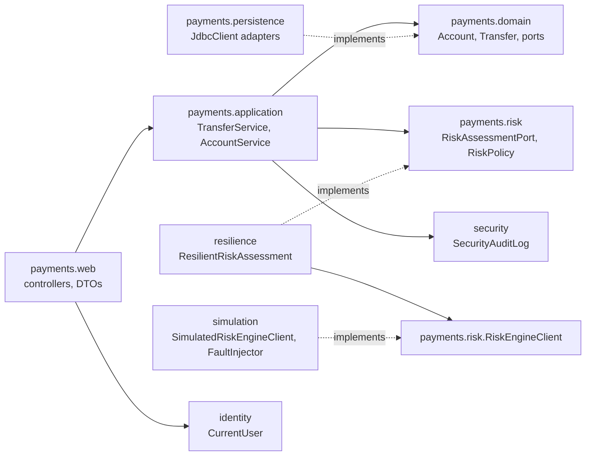

# Architecture

## Context

```mermaid
flowchart TB
    subgraph trust_internet[Untrusted: clients]
      client[API client / k6]
    end
    subgraph trust_lab[Docker network: lab]
      kc[Keycloak<br/>realm sentinel]
      api[sentinel-api :8080<br/>management :8081 internal only]
      db[(PostgreSQL)]
      otel[OTel Collector]
      obs[Prometheus · Tempo · Loki · Grafana]
    end
    client -->|1. password grant (lab only)| kc
    client -->|2. Bearer JWT| api
    api -->|JWKS over internal network| kc
    api --> db
    api -->|OTLP| otel --> obs
    obs -->|scrape :8081| api
```

## Module structure (modular monolith, light hexagonal)



Rules the code follows:

- `payments.domain` and `payments.risk` depend on nothing but the JDK (and `identity`).
- Adapters (`persistence`, `resilience`, `simulation`, `web`) depend inward, never the other way.
- Replacing the simulated risk engine with a real HTTP client means writing one class that implements
  `RiskEngineClient`; resilience, policy and telemetry stay as they are.

## Transfer flow

```mermaid
sequenceDiagram
    participant C as Client
    participant F as Filters (JWT, rate limit)
    participant S as TransferService
    participant R as ResilientRiskAssessment
    participant E as Risk engine
    participant D as PostgreSQL

    C->>F: POST /api/transfers (Bearer, Idempotency-Key)
    F->>S: authenticated, within budget
    S->>D: idempotency lookup, load accounts (auto-commit, short)
    S->>R: assess (outside any DB transaction)
    loop up to 3 attempts, exponential backoff + jitter
        R->>E: score (time limit 800ms, bulkhead 25)
    end
    R-->>S: Scored(score) or Unavailable(cause)
    S->>S: RiskPolicy.decide → COMPLETED / REJECTED / PENDING_REVIEW
    S->>D: BEGIN; lock accounts FOR NO KEY UPDATE (ordered); insert transfer; update balances; ledger; COMMIT
    S-->>C: 201 / 202 / 422 (problem details + trace_id)
```

## Decisions

| ADR | Decision |
|---|---|
| [0001](adr/0001-modular-monolith.md) | Modular monolith with one simulated dependency |
| [0002](adr/0002-telemetry-pipeline.md) | OpenTelemetry agent for traces and logs, Micrometer for metrics, exemplars bridged |
| [0003](adr/0003-resilience-and-degradation.md) | Resilience4j order, budgets and the degradation policy |
| [0004](adr/0004-identity-and-access.md) | Stateless resource server with an external OIDC provider |
