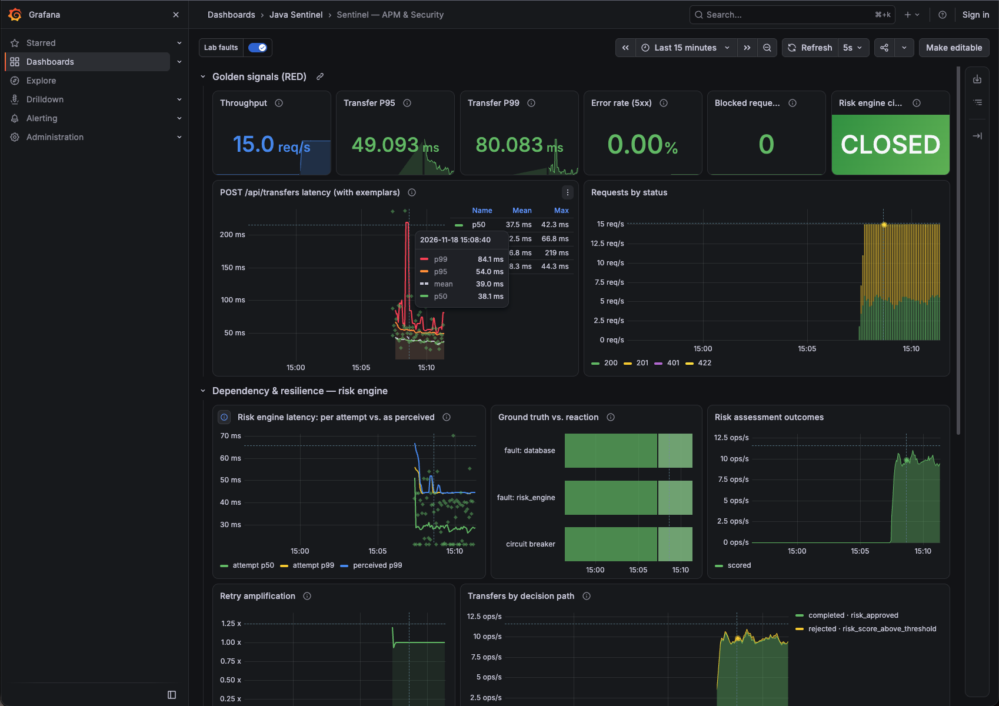
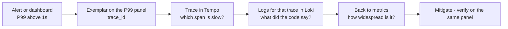

# Observability guide



## The investigation loop



Every hop is a click, no copy-pasting ids:

| From | To | How it is wired |
|---|---|---|
| Prometheus panel | Tempo trace | Exemplars on `*_seconds_bucket`; datasource `exemplarTraceIdDestinations` |
| Tempo span | Loki logs | `tracesToLogsV2` query `{service_name=...} \| trace_id="..."` |
| Loki log line | Tempo trace | Derived field on the `trace_id` structured metadata |
| Tempo span | Prometheus | `tracesToMetrics` + span metrics from Tempo's metrics generator |
| API error response | Everything | Every problem detail contains `trace_id` |

## Metric catalog

### RED (requests)

| Metric | Source | Use |
|---|---|---|
| `http_server_requests_seconds_bucket{uri,method,status,outcome}` | Spring MVC observation | Throughput, error rate, latency percentiles (with exemplars) |
| `sentinel_transfers_total{status,decision}` | `PaymentsMetrics` | Business outcomes; which decision path is active |

### Dependency and resilience

| Metric | Use |
|---|---|
| `sentinel_risk_engine_calls_seconds_bucket{outcome}` | Latency of each *attempt* against the dependency |
| `sentinel_risk_assessment_seconds_bucket{outcome}` | Latency as perceived by the transfer (attempts + backoff); outcome ∈ scored, timeout, circuit_open, bulkhead_full, error |
| `sentinel_risk_attempts_total` | ÷ assessments = retry amplification |
| `resilience4j_circuitbreaker_state{name,state}` | 1 for the current state |
| `resilience4j_circuitbreaker_failure_rate`, `..._slow_call_rate` | What is driving the breaker |
| `resilience4j_bulkhead_available_concurrent_calls` | Free permits |
| `resilience4j_retry_calls_total{kind}` | successful_without_retry, successful_with_retry, failed_with_retry, failed_without_retry |

### Saturation (USE)

| Metric | Use |
|---|---|
| `hikaricp_connections_active/idle/pending/max` | Pending > 0 = saturated database path |
| `hikaricp_connections_acquire_seconds_*` | Time waiting for a connection |
| `jvm_memory_used_bytes{area}`, `jvm_gc_pause_seconds_*` | Heap and GC pressure |
| `process_cpu_usage`, `jvm_threads_live_threads` | CPU; platform threads (virtual threads are not counted) |

### Security

| Metric | Use |
|---|---|
| `sentinel_security_events_total{type,endpoint_group}` | type ∈ authentication_failed, access_denied, ownership_violation, rate_limited, lab_fault_changed |
| `sentinel_lab_fault_active{target}` | Ground truth: 1 while a fault is injected (dashboard annotations) |

## Spans

| Span | Kind | Key attributes |
|---|---|---|
| `POST /api/transfers` | SERVER | `http.route`, `http.response.status_code` (agent) |
| `transfer execute` | INTERNAL | `sentinel.transfer.status`, `sentinel.transfer.decision` |
| `risk assessment` | INTERNAL | `sentinel.risk.outcome`, `sentinel.risk.attempts`, `sentinel.circuit_breaker.state` |
| `risk-engine POST /v1/score` | CLIENT (one per attempt) | `peer.service=risk-engine`, `sentinel.fault.injected_latency_ms`, `sentinel.risk.score` |
| `SELECT/INSERT/UPDATE ...` | CLIENT | `db.system.name`, `db.query.text` (sanitised) (agent) |

## Logs

- **Format**: ECS JSON on stdout (`logging.structured.format.console=ecs` in the `lab` profile) and OTLP to Loki.
- **Correlation**: the agent adds `trace_id`/`span_id`; Loki stores them as structured metadata.
- **Audit**: logger `sentinel.audit`, one event per security decision, with `audit.event`, `audit.principal`,
  `client.address`, `url.path` and event-specific keys. Query:

```logql
{service_name="sentinel-api"} | scope_name="sentinel.audit" | audit_event="ownership_violation"
```

- **Never logged**: tokens, passwords, request bodies, full SQL with literals.

## Useful queries

```promql
# P99 of transfers
histogram_quantile(0.99, sum by (le) (rate(http_server_requests_seconds_bucket{uri="/api/transfers",method="POST"}[1m])))

# Mean vs P99: the gap is the story
sum(rate(http_server_requests_seconds_sum{uri="/api/transfers"}[1m])) / sum(rate(http_server_requests_seconds_count{uri="/api/transfers"}[1m]))

# Retry amplification
sum(rate(sentinel_risk_attempts_total[1m])) / sum(rate(sentinel_risk_assessment_seconds_count[1m]))

# Top client addresses with failed authentication (logs → metrics)
topk(5, sum by (client_address) (count_over_time({service_name="sentinel-api"} | audit_event="authentication_failed" [5m])))
```

```traceql
# Slow transfers where the risk engine was retried
{ name = "risk assessment" && span.sentinel.risk.attempts > 1 } | select(span.sentinel.risk.outcome)

# Transfers that went through the degradation policy
{ span.sentinel.transfer.decision =~ "fallback.*" }
```

## Alerts

Defined in `infrastructure/prometheus/rules/sentinel-alerts.yml` and visible in Prometheus → *Alerts*:
error budget fast burn (multi-window, SLO 99.5%), transfer P99 > 1s, circuit open, retry storm, pool saturated,
authentication failure spike, ownership probing, rate limiting active, lab fault active.
